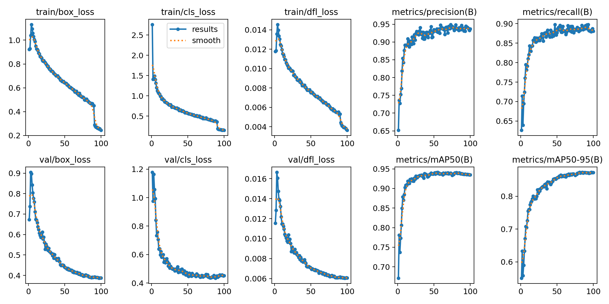
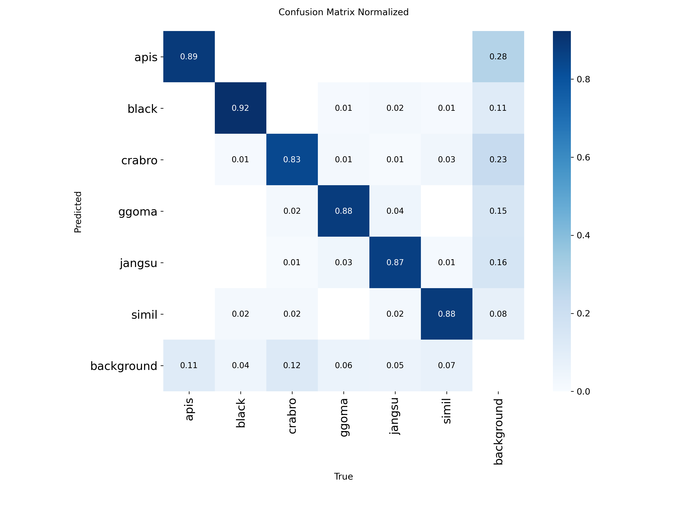

# Bee Species Classifier

YOLO로 벌 6종을 탐지/분류하고, Flask 웹에서 추론과 mAP 평가를 할 수 있게 만든 프로젝트입니다.

26-1, 개인 프로젝트

클래스: `apis`, `black`, `crabro`, `ggoma`, `jangsu`, `simil`

## 내용

- 1차 데이터셋 1,701장으로 모델을 학습하고, 이 모델로 새 이미지 6,616장에 라벨을 자동 생성했습니다. 빈 라벨을 정리해 6,575장을 남기고 기존 데이터와 합쳐 최종 8,276장으로 학습했습니다.
- YOLOv8s, YOLOv8m, YOLO26s, YOLO26m을 이미지 크기 640~960으로 바꿔 가며 비교했습니다.
- Flask 웹앱에서 모델 업로드/교체, 이미지 추론(박스 표시), COCO 형식 테스트셋 mAP 평가를 할 수 있습니다.

## 결과

검증셋 (학습 데이터의 20%)

| 모델 | 데이터 | imgsz | Precision | Recall | mAP50 | mAP50-95 |
|---|---|---|---|---|---|---|
| YOLOv8m | 1,701장 | 832 | 0.899 | 0.853 | 0.923 | 0.768 |
| YOLO26s | 8,276장 | 960 | 0.929 | 0.887 | 0.938 | 0.855 |
| YOLO26m (최종) | 8,276장 | 768 | 0.928 | 0.892 | 0.941 | 0.865 |

테스트셋 (별도 600장, COCO 형식)

| 모델 | Precision | Recall | mAP50 | mAP50-95 |
|---|---|---|---|---|
| YOLOv8s (1,701장, 640) | 0.766 | 0.765 | 0.781 | 0.517 |
| YOLOv8m (1,701장, 832) | 0.822 | 0.774 | 0.808 | 0.535 |
| YOLO26m (8,276장, 768) | 0.841 | 0.793 | 0.807 | 0.544 |

<p>
  
  
</p>

## 구조

```text
.
├── app/                 # Flask 웹앱
├── data_tools/
│   ├── auto_label.py    # 학습된 모델로 라벨 자동 생성
│   ├── clean_labels.py  # 빈 라벨, 짝이 없는 파일 정리
│   ├── build_dataset.py # 데이터 병합 + train/val 8:2 분할
│   └── coco_to_yolo.py  # COCO(test.json)를 YOLO 형식으로 변환
├── training/            # 학습 스크립트, data.yaml
├── evaluation/          # 테스트셋 mAP 평가, 폴더 단위 추론
├── results/             # 실험별 학습 로그(csv), 그래프
├── models/              # 모델 위치 (Releases에서 다운로드)
├── data/                # 데이터셋 위치 (저장소 미포함)
└── config.py
```

## 실행

```bash
python -m venv .venv
.venv\Scripts\activate
pip install -r requirements.txt
```

Releases에서 `best.pt`를 받아 `models/`에 넣습니다.

웹앱

```bash
python app/run.py
# http://127.0.0.1:5002
```

데이터 구축, 학습, 평가

```bash
python data_tools/auto_label.py --model models/best.pt --src data/raw --dst data/auto_labels
python data_tools/clean_labels.py --root data/auto_labels --apply
python data_tools/build_dataset.py --src data/first data/auto_labels --dst data/dataset
python training/train.py --model yolo26m.pt --imgsz 768 --batch 5 --epochs 100 --name yolo26m_img768
python evaluation/evaluate.py --model models/best.pt --test-dir data/test
```

## 데이터

학습 이미지는 저작권 문제로 저장소에 포함하지 않았습니다. `data/dataset/`에 YOLO 형식(`images/{train,val}`, `labels/{train,val}`)으로 넣으면 학습할 수 있습니다.

## 정리 내역

포트폴리오로 올리면서 다음을 정리했습니다.

- 흩어져 있던 학습/테스트/라벨링 스크립트를 `data_tools`, `training`, `evaluation`으로 합치고, 고정 경로를 상대 경로와 실행 인자로 바꿨습니다.
- 웹앱이 실행 시 `models/best.pt`를 자동으로 불러오도록 했습니다.

## 기술 스택

Python, Ultralytics YOLO, PyTorch, Flask, OpenCV

## 라이선스

[AGPL-3.0](LICENSE). Ultralytics YOLO(AGPL-3.0)를 사용하므로 같은 라이선스를 따릅니다.
